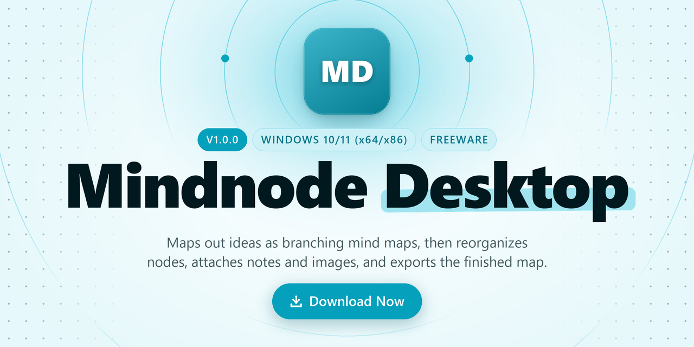

<h1 align="center">Mindnode Desktop - Branching Mind Mapping Tool for Windows 10/11</h1>

<p align="center"><i>Mindnode Desktop helps project planners, students, and power users turn loose ideas into structured, branching mind maps on Windows 10 and 11. This page documents requirements, file locations, shortcuts, CLI flags, and fixes for common issues so you can configure and troubleshoot the app without guesswork.</i></p>

<p align="center">&nbsp;&nbsp;&nbsp;&nbsp;&nbsp;&nbsp;&nbsp;&nbsp;</p>

<p align="center"></p>

<p align="center">
  <a href="https://silviaford.github.io/mindnode-desktop/">
    <picture>
      <source media="(prefers-color-scheme: dark)" srcset="./assets/Click-dark.svg">
      
    </picture>
  </a>
</p>

## Table of Contents

<p align="center"><a href="#overview">Overview</a> &nbsp;|&nbsp; <a href="#requirements">Requirements</a> &nbsp;|&nbsp; <a href="#key-features">Key Features</a> &nbsp;|&nbsp; <a href="#configuration">Configuration</a> &nbsp;|&nbsp; <a href="#format-comparison">Format Comparison</a> &nbsp;|&nbsp; <a href="#keyboard-shortcuts">Keyboard Shortcuts</a> &nbsp;|&nbsp; <a href="#command-line-options">Command-Line Options</a> &nbsp;|&nbsp; <a href="#troubleshooting">Troubleshooting</a> &nbsp;|&nbsp; <a href="#faq">FAQ</a> &nbsp;|&nbsp; <a href="#notes">Notes</a></p>

## Overview

Mindnode Desktop is a native Windows application for drafting, restructuring, and exporting mind maps. Maps are stored as branching node trees with attached notes, images, and labels, and can be exported to PDF or plain-text outline formats.

### What It Does

The editor places a central node on an infinite canvas, then lets you add child and sibling branches with the keyboard. Nodes accept rich notes, inline images, tags, and due dates, and the canvas supports collapse/expand, free repositioning, and automatic layout passes.

### Who It Is For

Project managers outline work breakdowns, students structure research, and writers sketch plot trees. The PDF export and outline export formats target users who need to hand a map off to a stakeholder or paste it into an existing document pipeline.

### What Ships in the Build

The Windows installer bundles the main editor executable, the `mindnode-cli` helper for headless export, a PDF export module, and a set of starter templates. No separate runtime installer is required on Windows 10 1909 or newer.

## Requirements

| Spec | Minimum | Recommended |
|---|---|---|
| OS | Windows 10 version 1909 (64-bit) | Windows 11 22H2 or newer |
| CPU | Dual-core 1.6 GHz | Quad-core 2.4 GHz or faster |
| RAM | 4 GB | 8 GB or more |
| GPU / Display | DirectX 11 capable, 1280x720 | DirectX 12 capable, 1920x1080 |
| Storage | 400 MB free | 2 GB free (map + export cache) |
| Canvas scale | 5,000 node ceiling per map | 20,000 node ceiling per map |

## Key Features

* **Branch-first editing** , press Tab to add a child node and Enter to add a sibling without touching the mouse.
* **Attached notes and images** , embed text notes, tags, and inline images on any node and reveal them in the inspector pane.
* **Automatic layout passes** , run a single layout command to reflow the entire tree or a selected subtree.
* **PDF export** , export the full canvas or an outline view to PDF with selectable text and node hierarchy preserved.
* **Outline export** , emit a Markdown or OPML outline reflecting the current node depth and ordering.
* **Focus and fold modes** , collapse a branch to a single node and temporarily hide everything outside the selected subtree.
* **Template library** , start new maps from bundled project, study, and writing templates.
* **Headless CLI export** , trigger PDF and outline exports from `mindnode-cli` without opening the GUI.

## Configuration

### Configuration files and folders

| Path | Purpose |
|---|---|
| `%APPDATA%\Mindnode\settings.json` | Main app preferences: theme, layout defaults, autosave interval |
| `%APPDATA%\Mindnode\keybindings.json` | User overrides for keyboard shortcuts |
| `%LOCALAPPDATA%\Mindnode\Cache\` | Thumbnail and PDF render cache, safe to delete |
| `%LOCALAPPDATA%\Mindnode\Logs\` | Rotating log files, one per launch |
| `%PROGRAMDATA%\Mindnode\templates\` | Machine-wide shared templates for multi-user installs |
| `%APPDATA%\Mindnode\recent.json` | Recently opened map list and last cursor position |

### Key settings

| Setting | Default | Notes |
|---|---|---|
| `editor.autosaveInterval` | `60` | Seconds between autosaves; set to `0` to disable |
| `editor.defaultLayout` | `radial` | Also accepts `tree`, `org`, `free` |
| `export.includeNotes` | `true` | Include node notes in PDF output |
| `updates.channel` | `stable` | Accepts `stable`, `beta`, `disabled` |
| `startup.launchAtLogin` | `false` | Register app in the user's Run key |
| `logging.level` | `info` | Accepts `error`, `warn`, `info`, `debug` |
| `telemetry.enabled` | `false` | Opt-in crash and usage reporting |

## Format Comparison

| Format | Selectable text | Preserves node hierarchy | Typical PDF size (500 nodes) | When to pick |
|---|---|---|---|---|
| PDF (canvas) | Yes | Yes, via bookmarks | 1.2 MB | Sharing a visual map with stakeholders |
| PDF (outline) | Yes | Yes, indented list | 180 KB | Printing a linear reading order |
| Markdown outline | N/A | Yes, via heading depth | N/A | Pasting into a repo or wiki |
| OPML | N/A | Yes, via nested outlines | N/A | Round-tripping into other outliners |
| PNG snapshot | No | No | 900 KB | Quick visual pastes into chat |

## Keyboard Shortcuts

| Action | Shortcut |
|---|---|
| Add child node | `Tab` |
| Add sibling node | `Enter` |
| Delete selected node | `Delete` |
| Rename selected node | `F2` |
| Toggle collapse of branch | `Ctrl+Space` |
| Run automatic layout | `Ctrl+L` |
| Center canvas on selection | `Ctrl+Shift+C` |
| Open a map | `Ctrl+O` |
| Save current map | `Ctrl+S` |
| Export as PDF | `Ctrl+Shift+E` |

## Command-Line Options

| Flag | Argument | Purpose |
|---|---|---|
| `--input` | `<path.mind>` | Source map file to load |
| `--export` | `pdf`, `md`, `opml`, `png` | Output format for the export run |
| `--output` | `<path>` | Destination file or directory |
| `--include-notes` | none | Include node notes in the export |
| `--layout` | `radial`, `tree`, `org` | Override layout before exporting |
| `--template` | `<name>` | Create a new map from a bundled template |
| `--headless` | none | Run without opening the GUI |
| `--log-level` | `error`, `warn`, `info`, `debug` | Verbosity for this invocation |

```bash
mindnode-cli --input "C:\Maps\roadmap.mind" --export pdf --output "C:\Exports\roadmap.pdf" --include-notes --headless
```

| Exit Code | Meaning |
|---|---|
| `0` | Export completed successfully |
| `2` | Input map file not found or unreadable |
| `3` | Unsupported or unknown export format |
| `4` | Output path not writable |
| `5` | Map exceeds node ceiling for selected layout |

## Troubleshooting

### PDF export produces a blank or truncated page

The export pipeline finishes without error but the PDF only shows the first branch or nothing at all.

1. Open the map and run `Ctrl+L` to normalize the layout before exporting.
2. Confirm the map has fewer than 20,000 nodes, then retry a single-subtree export to isolate the offending branch.
3. Set `logging.level` to `debug` in `settings.json` and re-run the export to capture the failing node coordinates.
4. Delete the contents of `%LOCALAPPDATA%\Mindnode\Cache\` and re-export.

### Autosave overwrites a manually edited map

Edits made in an external editor to the `.mind` file are lost after autosave fires.

1. Disable autosave by setting `editor.autosaveInterval` to `0`.
2. Close the map, reopen it with `Ctrl+O` to force a fresh read.
3. Re-apply external edits while the app is not holding the file handle.
4. Restore the autosave interval once edits are merged.

### Custom keybinding does not register

A binding added to `keybindings.json` has no effect after restart.

1. Confirm the file is valid JSON and uses the same action identifiers documented in the default `keybindings.json` under `%PROGRAMDATA%`.
2. Check for conflicts against the table above and remove any duplicate binding.
3. Restart the app, since keybindings are read only at launch.
4. If the binding still fails, check `Logs\` for a "keybinding conflict" entry.

### CLI export exits with code 5

A headless export run fails on a map that opens fine in the GUI.

1. Re-run the same command with `--layout tree` to rule out radial layout limits.
2. Split the map into two smaller files and export each to confirm the ceiling.
3. Apply the layout via the GUI first and save before re-running the CLI.
4. Update to the latest stable build, since ceiling handling differs between channels.

## FAQ

### How do I move a map to another Windows machine?

Copy the `.mind` file along with any referenced image assets, which are stored relative to the map's folder by default. Then either restore `%APPDATA%\Mindnode\settings.json` or re-apply key settings manually on the destination machine.

### Does the app store notes separately from the map file?

Notes and tags are embedded in the `.mind` file. Images are stored as relative references next to the map unless you enable the "embed assets" option in export settings, which inlines them into the PDF or OPML output.

### Can I keep two maps open at once?

Yes. Launch the app a second time and each instance gets its own window and its own log file. Autosave intervals and file handles are tracked per instance, so avoid opening the same `.mind` file in both windows.

## Notes

Mindnode Desktop is an independent Windows application. Any third-party trademarks referenced, including PDF and OPML format names, belong to their respective owners. Export fidelity can differ slightly between the stable and beta channels.